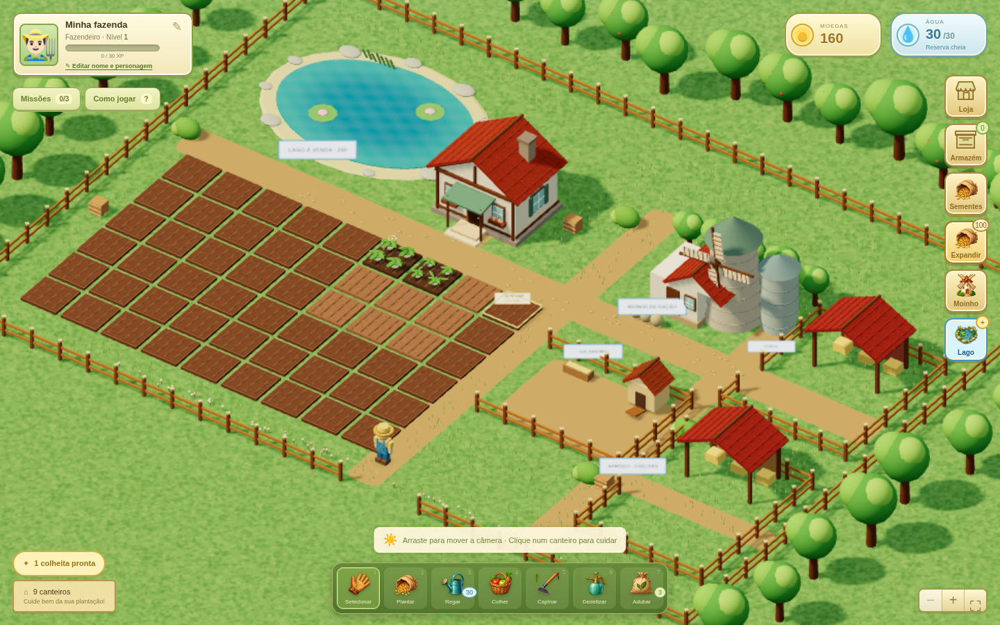

# GAME-2 — Colheita Feliz 3D, versão 0.8.1

Jogo de fazenda para navegador, independente do GAME-1. Mantém o ciclo de cuidado do **Colheita Feliz** e agora usa uma fazenda **3D cartoon**, seguindo a nova direção escolhida pelo usuário. A implementação e os modelos 3D são próprios; não são recursos do cliente original. Ainda é uma versão para um jogador, com progresso salvo no navegador.



A interface ocupa toda a janela do navegador. Cada fazenda começa com os recursos iniciais descritos abaixo.

## Jogar

No pacote, extraia a pasta e abra **JOGAR.html** no Chrome, Edge ou Firefox atualizado. Se baixar o código pelo GitHub, a entrada pronta é **index.html**. O HTML inclui código, interface, biblioteca 3D e recursos visuais; não faz downloads durante o jogo. A visão 3D requer WebGL 2. Se o navegador não conseguir iniciar o renderizador, o jogo avisa e abre a fazenda 2D compatível.

Clique num **canteiro vazio** para abrir as sementes. Escolher um cultivo manda o fazendeiro plantar naquele terreno; fechar ou pressionar Escape cancela sem gastar sementes. Para os outros cuidados, selecione a ferramenta e clique na plantação. O fazendeiro caminha pelas passagens, vira para a plantação e realiza a ação com o objeto na mão:

- Plantar: bolsa de sementes e movimento de semear.
- Regar: regador com água.
- Colher: cesta e movimento para recolher a produção.
- Capinar: enxada.
- Dedetizar: pulverizador.
- Adubar: saco de adubo.

A alteração acontece durante a animação, após chegar ao canteiro. É possível selecionar vários canteiros para formar uma fila de até 12 tarefas. Cada tarefa conserva a ferramenta e a semente escolhidas no clique; cliques repetidos na mesma tarefa não duplicam produtos. As condições são verificadas novamente quando a ação acontece. Uma tarefa ainda não aplicada não gasta sementes ou adubo e não é salva ao fechar a aba.

Use os botões **+ / −** ou o scroll sobre a fazenda para aproximar ou afastar a câmera. Os atalhos **1 a 7** selecionam ferramentas; **Tab e Enter** também permitem acionar os canteiros. A interface funciona por toque. A versão 2D continua disponível em `?view=classic`.

## Movimento e câmera — versão 0.8.1

A caminhada e o arraste da câmera usam o ritmo de atualização do navegador, sem o limite anterior de cerca de 30 FPS. Os eventos do mouse são acumulados por quadro e os canteiros mantêm os mesmos elementos de clique, inclusive o foco por teclado. Árvores, moinho, personagens e indicadores de colheita usam menos chamadas gráficas.

O cenário conserva as sombras do sol; fazendeiro e animais usam sombras suaves de contato, sem recalcular as sombras da fazenda inteira durante cada passo. A resolução do 3D se adapta ao tempo dos quadros, com recuperação gradual quando há folga. A interface em HTML continua na resolução da tela.

As medições antes/depois, o cenário de teste e suas limitações estão em [docs/DESEMPENHO.md](docs/DESEMPENHO.md). O resultado depende da placa gráfica e do navegador; os testes por software deste ambiente não comprovam 60 FPS no computador de cada jogador.

## Fazenda em toda a janela — versão 0.8.0

- Cenário ocupa toda a página, sem rolagem da página, no computador e no celular. Janelas de loja, sementes e armazém rolam internamente quando necessário.
- Moedas e reserva de água no canto superior direito; personagem no canto superior esquerdo. Moinho, lago, loja e armazém continuam disponíveis na lateral.
- Sementes aparecem ao clicar num canteiro vazio. A seleção planta nesse canteiro; a animação continua consumindo a semente apenas durante a ação. O botão Sementes permite consultar o estoque e acessar a loja.
- **Segure o botão esquerdo e arraste sobre o mapa** para mover a câmera. O arraste funciona também sobre canteiros, sem colher, plantar ou fazer o personagem andar ao soltar. Clique simples mantém as ações. O enquadramento fica onde foi deixado até um novo comando ao personagem; o zoom continua funcionando.

[Ver a escolha de sementes](docs/images/sementes-v081.png).

## Arte pintada, campo ampliado e moinho — versão 0.7.0

- Cultivos, produtos e ferramentas com ilustrações próprias em estilo cartoon pintado, fundos creme, títulos verdes e botões dourados, seguindo a referência do usuário. Preços, tempos, quantidades e nomes continuam como texto legível do jogo. Os recursos são embutidos no HTML.
- Lago aproximadamente três vezes maior em área, com margem percorrível, peixes e gaiolas. Os contadores ficam no canto superior direito. Casas com telhados, varanda, vigas, janelas laterais e materiais mais detalhados; iluminação e animações ambientais revistas.
- **54 terrenos de plantio** ocupam a área até a cerca. A fazenda começa com os mesmos nove terrenos livres; os demais são expandidos com moedas. Os primeiros 16 índices e suas plantações são preservados ao migrar saves antigos.
- Cavalos removidos. O **aprisco recebe ovelhas compradas na loja**: custam 120 moedas, são liberadas no nível 2, produzem lã a cada 90 segundos e usam a mesma ração de ruminantes das vacas.
- **Soja e alfafa** disponíveis no nível 1. Novas fazendas recebem três sementes de cada; saves anteriores conservam seus itens e podem comprar as novas sementes na loja.
- Clique no moinho no cenário ou no botão **Moinho** da lateral. Receitas usam **a colheita no armazém**, sem gastar sementes ou moedas. O preparo leva tempo, continua offline e precisa ser recolhido antes de iniciar outra receita.

| Receita | Ingredientes colhidos | Produção | Tempo |
| --- | --- | --- | --- |
| Aves | 2 trigos + 1 soja | 3 sacos | 20 s |
| Aves com milho | 2 milhos + 1 soja | 4 sacos | 25 s |
| Ruminantes | 2 alfafas + 1 trigo | 3 sacos | 20 s |
| Aquática | 2 sojas + 1 trigo | 3 sacos | 25 s |

[Ver os cartões ilustrados](docs/images/cartoes-v07.png) · [Ver o moinho de ração](docs/images/moinho-v07.png)

Um saco alimenta uma criação por quatro ciclos. Galinhas usam ração de aves; vacas e ovelhas usam ração de ruminantes; peixes e gaiolas de camarões usam ração aquática. Sem ração, a produção pausa, inclusive offline. A primeira alimentação de cada animal/criação comprado continua incluída. A reserva de água das plantações permanece independente.

O lago custa 240 moedas no nível 2; uma criação de peixes custa 60 moedas e até três gaiolas de camarões custam 120 moedas cada (nível 3). Peixes produzem a cada minuto e valem 24 moedas; camarões produzem a cada 90 segundos e valem 38 moedas. Preços, receitas e tempos são parâmetros provisórios do jogo, sem afirmar equivalência nutricional real.

## Água, personagem e expansão — versão 0.5.1

- A fazenda começa com **30 águas**. Cada canteiro regado gasta uma; a reserva recupera **uma água a cada 2 minutos**, até 30, inclusive offline. Água e moedas aparecem juntas no topo, com a contagem para a próxima carga. Gastar mais água não reinicia uma recarga em andamento. Reabrir o jogo mantém o tempo restante.
- Sem água disponível, a rega é bloqueada e a plantação continua seca. No 3D, o consumo acontece durante a animação, com nova validação para cada tarefa da fila. Saves anteriores recebem a reserva cheia sem perder seus itens.
- **WASD**, setas e clique no chão movem o personagem na fazenda 3D. O clique procura um caminho livre; casas, lago e canteiros plantáveis delimitam os percursos. Mover manualmente cancela tarefas pendentes, antes de consumir recursos.
- Clique no **avatar no topo** para escolher **fazendeiro ou fazendeira** e editar o nome da fazenda. Confirme no botão **Aplicar nome e personagem**. A escolha altera o modelo 3D, o avatar e fica salva. Nomes inválidos geram um aviso dentro da janela. O botão e a tecla Enter aplicam as mudanças diretamente, inclusive em prévias que bloqueiam o envio de formulários. Se o navegador bloquear o armazenamento, a interface avisa que as alterações duram apenas nesta aba.
- Terrenos bloqueados têm bordas douradas e placas de **Expandir** com o preço. O botão **Expandir** na lateral abre a compra do próximo canteiro. A compra continua exigindo as moedas correspondentes.

O aumento da capacidade de água conforme o nível foi solicitado para uma próxima etapa; nesta versão, a capacidade é 30 em todos os níveis.

## Mecânicas preservadas

- Nove canteiros iniciais, expansão até 54 e dez cultivos: nabo, cenoura, trigo, morango, milho, abóbora, tomate, melancia, soja e alfafa.
- Duas plantações iniciais de nabo, já regadas.
- Sem água, a planta não cresce, inclusive fora do jogo. A primeira rega inicia o ciclo com 25% de bônus; adubo adianta mais 20% depois da rega. O tempo seco não acumula.
- Saúde das plantas, ervas daninhas, pragas e bônus de produto ao capinar e dedetizar o cultivo.
- Compra de sementes e adubo, armazém, venda da produção, experiência, níveis e missões com recompensas únicas.
- Galinhas, vacas e ovelhas com ração fabricada, ovos/leite/lã, coleta e venda. Sem alimento, a produção fica pausada, inclusive offline.
- Nome da fazenda editável, bolsa de sementes e loja por categorias.
- Salvamento local, backup de progresso ilegível e aviso se o navegador bloquear o armazenamento.

Os ciclos duram de 30 segundos a 6 minutos para facilitar a avaliação. Preços, tempos, XP e bônus são provisórios, sem afirmar equivalência com os parâmetros do jogo histórico. O progresso da versão anterior é preservado pela mesma chave de salvamento.

## Desenvolver

Requer **Node.js 22+**. Three.js e esbuild têm versões registradas no lockfile; a biblioteca é embutida no HTML durante a compilação, sem CDN. Os testes usam Playwright.

```sh
npm ci
npm start
```

O servidor local usa a porta 3000. `PORT=3001 npm start` usa outra porta. Também é possível servir a pasta `public/` em uma hospedagem estática.

```sh
npm run build
npm test
npm run test:browser
```

`npm run build` gera três entradas autocontidas idênticas: `index.html`, `public/index.html` e `dist/JOGAR.html`. Edite `src/index.template.html`, `public/app.js`, `public/game.js`, `public/art.js`, `public/farm3d.js` e `public/style.css`; não edite o HTML gerado manualmente.

Os testes de navegador usam Chromium em `/usr/bin/chromium` neste ambiente. Em outra máquina, defina `CHROMIUM_PATH` para o executável instalado. No PowerShell:

```powershell
$env:CHROMIUM_PATH = "C:\Program Files\Google\Chrome\Application\chrome.exe"
npm run test:browser
```

O Chromium gerenciado deste ambiente bloqueia `file://`. O HTML independente é testado por HTTP como único arquivo disponível, incluindo iframe isolado sem recursos auxiliares. A abertura direta por dois cliques não foi verificada aqui.

## Visual e desempenho

`public/farm3d.js` constrói os modelos: fazendeiro com rig, seis ferramentas, culturas, casas, cercas, árvores, lago, galinheiro e animais. Luz e sombras são reais. Árvores, água e animais têm movimentos suaves; a preferência de movimento reduzido desliga os movimentos ambientais, preservando a execução das tarefas. Geometria estática é agrupada por material e a grama usa instâncias. O renderizador adapta a resolução e atualiza as sombras estáticas quando o cenário muda.

A camada SVG transparente acompanha a projeção da câmera e oferece alvos de clique e navegação por teclado. A economia e o salvamento usam as mesmas regras em ambas as vistas. A vista 2D conserva o cenário e o solo gerados da versão 0.3, documentados em `public/assets/provenance.json`. Three.js usa licença MIT, incluída em `licenses/THREE-MIT.txt`.

## O que ainda falta para o evento

Esta versão é local. **GitHub armazena o código; não fornece, por si só, partidas online.** Contas, servidor persistente, visitas entre amigos, ajuda e roubo de colheitas ainda precisam ser implementados e validados para os cerca de 30 participantes. A hospedagem na VPS Windows será tratada depois do jogo, conforme a prioridade definida pelo usuário.

O guia histórico está em [docs/REFERENCIA.md](docs/REFERENCIA.md). Não há modelos ou código do RPG GAME-1 neste projeto.
